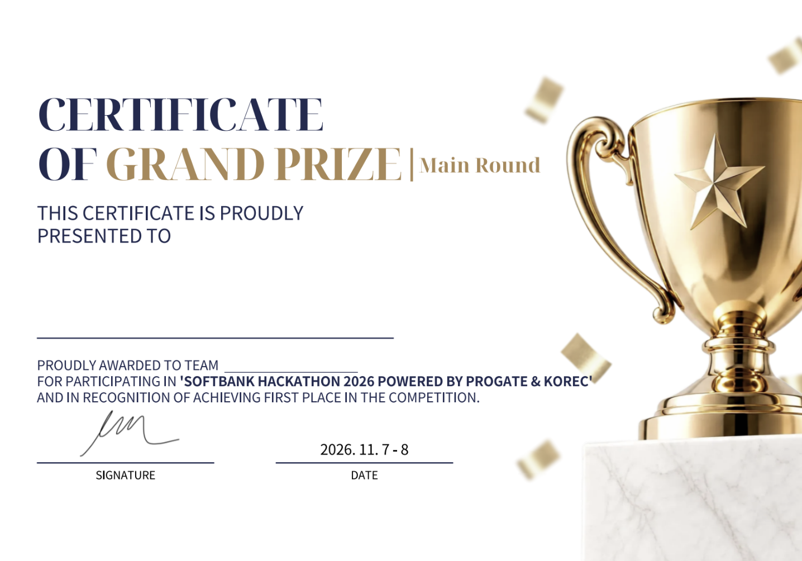
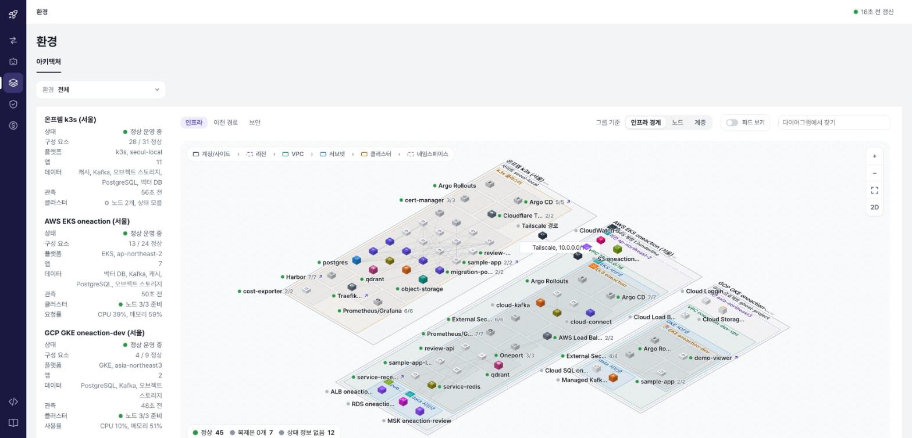
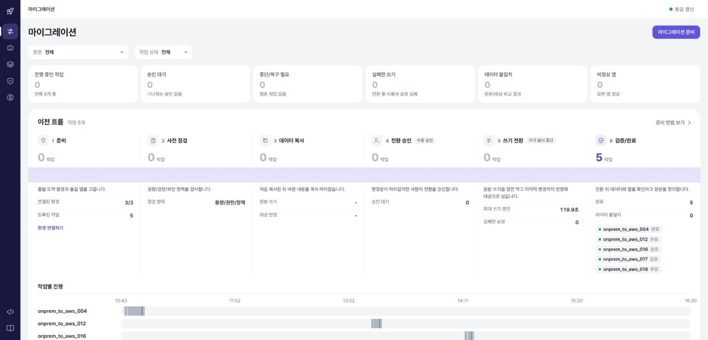
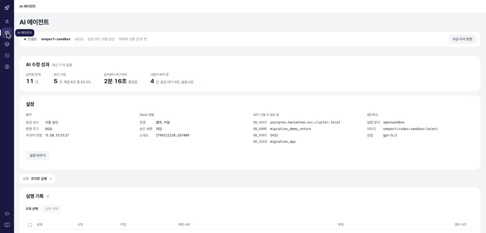
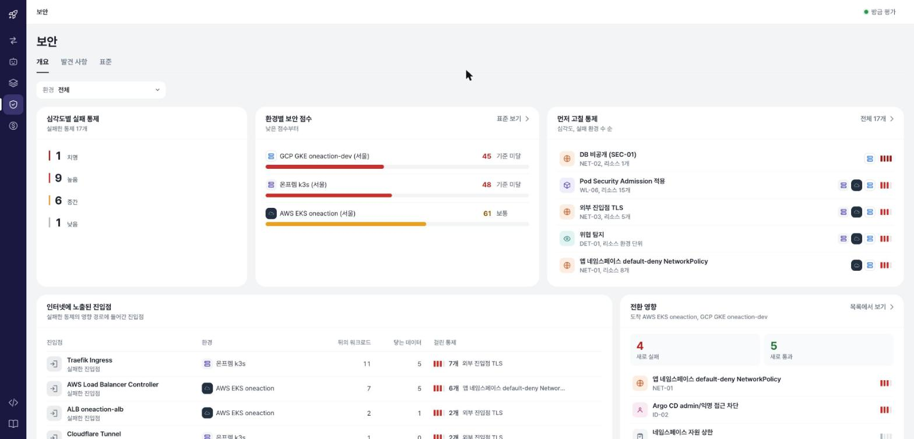
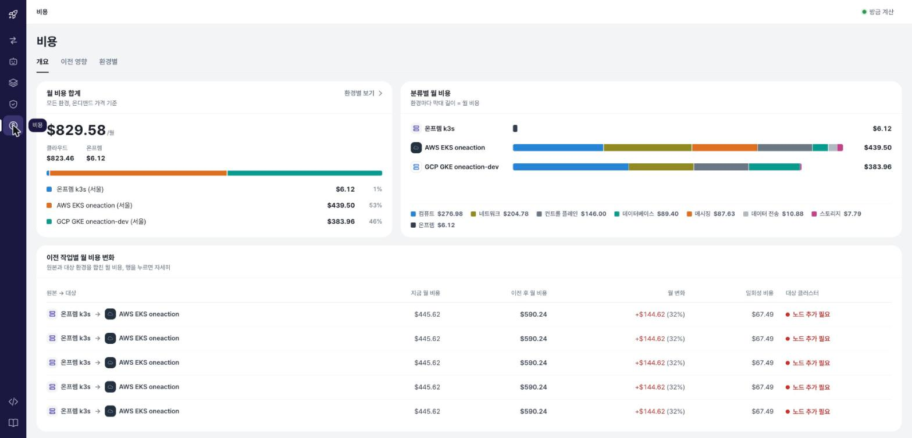
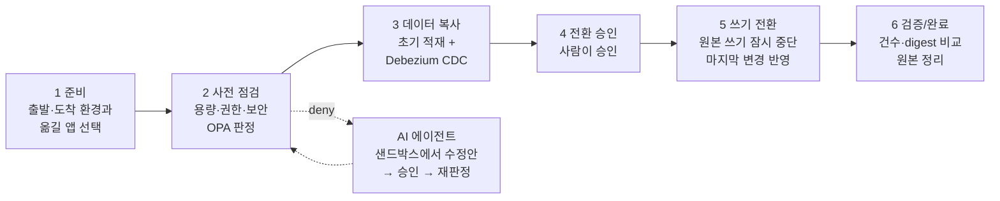

<div align="center">

# 👻 Team Ghost — SoftBank Hackathon 2026

**Oneport: 온프렘 ↔ AWS ↔ GCP 사이에서 앱과 DB를 쓰기 유실 없이 옮기고, 정책·보안·AI 수정·비용까지 한 화면에서 다루는 멀티 클라우드 이전 플랫폼**

🏆 **최우수상 수상! 함께 노력해주신 우리팀 고생많았습니다!**
SoftBank Hackathon 2026 powered by Progate & KOREC · Main Round Grand Prize · 2026.11.7 – 8



[](https://github.com/SoftBankHackathon2026/Hackathon)
[](https://github.com/SoftBankHackathon2026/gitops)
[](https://github.com/SoftBankHackathon2026/oneaction-infra)



</div>

---

## 왜 만들었나

프로덕션에서 멀티 클라우드를 운영하면 환경을 옮기는 일이 가장 무섭다. 복제가 끝났는지, 대상 앱이 DB에 붙는지, 보안 기준을 넘는지, 비용이 얼마나 늘지, 중간에 장애가 나면 누가 고치는지를 각각 다른 도구로 확인해야 한다.

Oneport는 **무중단으로 환경과 애플리케이션을 함께 이관**하는 데 집중한다. 그 과정에 필요한 판단(정책), 근거(보안 검사), 수정(AI 에이전트), 비용 추산을 하나의 플랫폼으로 묶었다.

## 무엇을 하나

| | 기능 | 한 줄 요약 |
|---|---|---|
| 🔀 | **마이그레이션** | 온프렘 PostgreSQL → RDS를 Debezium CDC로 복제하고, 쓰기를 잠깐 멈춘 뒤 마지막 변경까지 반영해 대상으로 넘긴다. 앱·접수 큐·Redis 원장도 같이 옮긴다 |
| 🗺️ | **환경** | 연결된 모든 환경(온프렘 k3s · AWS EKS · GCP GKE)의 아키텍처를 2D/3D 캔버스로 본다. 리소스를 클릭하면 계층·파드 상태·연결된 앱·보안·비용이 나온다 |
| 🤖 | **AI 에이전트** | OPA가 대상 앱 DB 연결 실패로 전환을 막으면 Codex가 샌드박스에서 원인을 추측하고 설정값을 고친다. 프로덕션 반영은 **반드시 사람 승인** 뒤. Slack에서도 승인·제어할 수 있다 |
| 🛡️ | **보안** | 환경별 보안 점수, 먼저 고칠 통제, 인터넷에 노출된 진입점, 전환이 만드는 새 실패/통과. CIS Benchmark · CSP 권장 가이드 · ISMS · ISMAP 기준별 준수 현황 |
| 💰 | **비용** | 모든 환경의 월 비용 합계와 분류별 비용. 클라우드는 실제 API, 온프렘은 홈랩 전기 요금·VM 수·CPU 사용률로 추정. 이전 전후 비용 변화도 작업별로 본다 |

<table>
<tr>
<td width="50%"></td>
<td width="50%"></td>
</tr>
<tr>
<td align="center"><sub>마이그레이션 — 준비 → 사전 점검 → 데이터 복사 → 전환 승인 → 쓰기 전환 → 검증/완료</sub></td>
<td align="center"><sub>AI 에이전트 — 고칠 수 있는 키는 코드가 정하고, 적용은 사람이 승인한다</sub></td>
</tr>
<tr>
<td width="50%"></td>
<td width="50%"></td>
</tr>
<tr>
<td align="center"><sub>보안 — 지금 집중해야 할 대상이 먼저 보인다</sub></td>
<td align="center"><sub>비용 — 어떤 자원이 어떻게 바뀌어 얼마가 늘고 주는지</sub></td>
</tr>
</table>

## 한 번의 이전이 지나가는 길



- **쓰기는 한쪽만 받는다.** 전환 전에는 온프렘 앱만, 전환 후에는 AWS 앱만 사용자 쓰기를 받는다. 대상 DB에는 CDC 계정만 데이터를 넣는다.
- **접수 큐가 요청을 잃지 않는다.** 쓰기를 멈춘 구간의 요청은 접수 서비스가 보관했다가 전환 뒤 대상으로 보낸다.
- **정책이 단계를 연다.** 단계마다 OPA가 allow / hold / deny를 낸다. 수치(대기 상한·증거 유효기간·승인 위치)는 정책이 아니라 계획이 가진다.
- **AI는 정해진 범위만 고친다.** 허용 키는 코드가 정하고, 비밀값 키는 정적 검사에서 거절된다. 성공은 재판정이 `allow`일 때만이다.

## 저장소

```text
Hackathon        코드      플랫폼(platform/)·이전 러너(migration/)·정책(policies/)·AI 에이전트(agent/)·클라우드 간 이전(crosscloud/). CI가 이미지를 GHCR에 올린다
      │ 이미지
      ▼
gitops           선언      Kubernetes 매니페스트와 Argo CD Application. 클러스터 상태의 유일한 원본
      │ Argo CD sync
      ▼
k3s(온프렘) · AWS EKS · GCP GKE     실제 실행 환경
      ▲
oneaction-infra  AWS 땅    Terraform. VPC·EKS·RDS·MSK·ALB 등 클러스터 바깥 리소스

sample-app       데모 앱   이전 대상이 되는 샘플 웹앱. CI가 이미지를 올리고 gitops 태그를 갱신
review-service   AI 리뷰   배포 명세를 검토해 pass / fix / needs_human 을 내는 서비스
```

| 저장소 | 무엇이 들어가나 | 스택 |
|---|---|---|
| [Hackathon](https://github.com/SoftBankHackathon2026/Hackathon) | [`platform/`](https://github.com/SoftBankHackathon2026/Hackathon/tree/main/platform) 관리 플랫폼 · [`migration/`](https://github.com/SoftBankHackathon2026/Hackathon/tree/main/migration) seed·CDC·전환·검증 · [`policies/`](https://github.com/SoftBankHackathon2026/Hackathon/tree/main/policies) OPA 정책 · [`agent/`](https://github.com/SoftBankHackathon2026/Hackathon/tree/main/agent) AI 수정 에이전트 · [`crosscloud/`](https://github.com/SoftBankHackathon2026/Hackathon/tree/main/crosscloud) AWS↔GCP 이전 | Python 3.12 · FastAPI · React 19 · Debezium · OPA · Codex |
| [gitops](https://github.com/SoftBankHackathon2026/gitops) | Kustomize 매니페스트(`apps/*`), Argo CD Application(`argocd/*`). 클러스터는 손으로 고치지 않고 여기서만 바꾼다 | Argo CD · Argo Rollouts · Kustomize |
| [oneaction-infra](https://github.com/SoftBankHackathon2026/oneaction-infra) | AWS Terraform 스택. 상태는 S3 + DynamoDB 잠금 | Terraform |
| [sample-app](https://github.com/SoftBankHackathon2026/sample-app) | 어느 환경이 응답했는지 보여주는 Express 앱. PR → AI 검토 → 자동 병합 → 카나리 배포 | Node · Express |
| [review-service](https://github.com/SoftBankHackathon2026/review-service) | 배포 명세 검토. Review API · Kafka · LangGraph 워커 | Python · FastAPI · Kafka · LangGraph |

**흐름:** 코드 → 이미지(GHCR) → 선언(gitops) → 적용(Argo CD → 클러스터). AWS 리소스는 oneaction-infra가 따로 만들고, gitops 설정에 그 주소를 넣으면 연결된다.

## 작업 규칙

- 모든 변경은 feature 브랜치 → PR. PR 본문은 각 저장소의 템플릿(🐛 bugfix · 🆕 feature · 🔧 improvement · 📝 design · ⚙️ infra · 🔒 security)을 따르고 작업 카드·Notion 링크를 붙인다.
- 클러스터·클라우드를 직접 수정하지 않는다. gitops / oneaction-infra 를 고치고 적용한다.
- 비밀번호·토큰·kubeconfig는 저장소에 넣지 않는다. 환경변수와 Secret 참조만 쓴다.

## 팀

**Team Ghost**

| | 이름 | 담당 |
|---|---|---|
|  | **원가연** [@silano08](https://github.com/silano08) | DB 이전(온프렘 → AWS)과 무중단 접수·전체 서비스 이전, 정책 검사(OPA), 플랫폼 앱 선택·전환 제어 |
|  | **김유빈** [@devyubin](https://github.com/devyubin) | 인프라 구축, 플랫폼 개발 및 인프라 연결, 온프렘 AI 에이전트 연결 및 샌드박스 구축 |
|  | **김태윤** [@xodbs1021](https://github.com/xodbs1021) | 클라우드 ↔ 클라우드(AWS ↔ GCP) 이전: 구성 파악·판정, 대상 인프라 생성(Terraform), Secret·감사 기록 이관, 트래픽 이동 |
|  | **김혜연** [@Hyeyeon-Kim](https://github.com/Hyeyeon-Kim) | DB 이전(AWS → 온프렘), 온프렘 AI 에이전트 |
|  | **김화균** [@callme-waffle](https://github.com/callme-waffle) | 온프레미스 인프라 보안 연결 및 마이그레이션 환경 초기 준비 프로세스 구현, GCP 시연 환경 준비, 거버넌스 정보 수집 |
